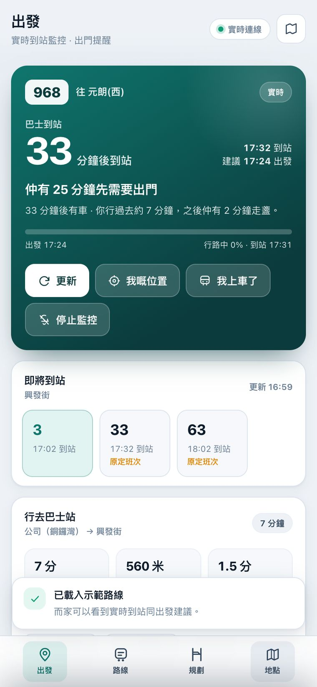
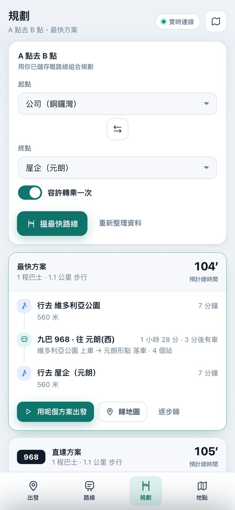
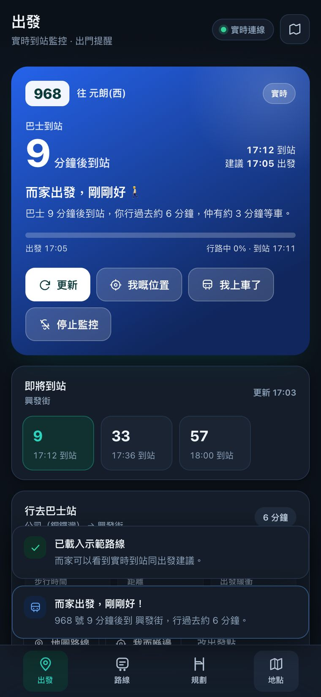
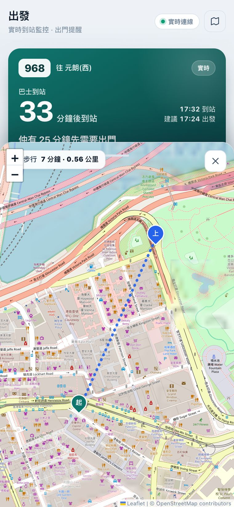
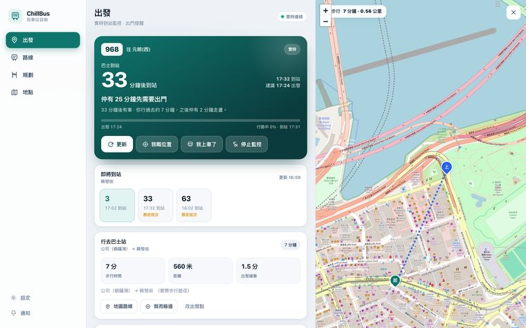

# ChillBus 🚌 · 搭車從容啲

> 唔使再為咗趕巴士拼命跑。
> ChillBus 幫你計好「幾點要出門」——用**實時到站時間 − 你行去巴士站嘅時間 − 保險時間**，
> 喺啱嘅一刻彈窗提醒你，之後一路睇住班車，夠鐘提你落車。

一個可以**直接部署到 GitHub + Vercel** 嘅單頁應用（SPA）。純前端 + 一個 Serverless 代理，
冇 build step、冇資料庫、冇帳號，所有個人資料只留喺你部裝置。

| 實時監控（手機） | A 點到 B 點規劃 | 深色模式 |
|---|---|---|
|  |  |  |

| 步行導航地圖 | 桌面版（左內容 + 右地圖） |
|---|---|
|  |  |

---

## ✨ 功能

| # | 功能 | 說明 |
|---|------|------|
| 1 | **儲存出發點** | 屋企／公司／其他地點，地址搜尋、瀏覽器定位或喺地圖上揀位 |
| 2 | **計算出發點 → 車站時間** | OpenStreetMap 實際步行路徑（OSRM），顯示時間、距離 |
| 3 | **出發彈窗提醒** | 到站時間 − 步行時間 − 緩衝 = 出門時間；狀態由「慢慢行」→「準備出門」→「而家出發」→「最後召集」 |
| 4 | **實時監控到站** | 九巴／龍運／城巴實時 ETA，每 15–120 秒自動更新，仲有下一班倒數 |
| 5 | **多條路線 + 反轉** | 儲存多條路線、上下車站；一撳反轉圖示即切換來回方向 |
| 6 | **複製路線** | 一撳複製，方便整「特別班次」或「下雨天版本」 |
| 7 | **A 點 → B 點規劃** | 用你已儲存嘅路線組合，自動配對上車／落車／轉乘站，計出最快方案 |
| ➕ | **落車提醒** | 撳「我上車了」之後改為追蹤落車站，到站前彈窗提你按鐘 |
| ➕ | **PWA** | 可加至手機主畫面、支援離線外殼（實時資料仍需要網絡） |

### 適用流程

```
(公司 → 屋企)
  ① 喺「出發」頁揀路線  →  ② 撳「開始監控」
  ③ App：巴士 9 分鐘後到站，你行過去 6 分鐘，仲有 3 分鐘走盞
  ④ 夠鐘彈窗：「而家出發，剛剛好！」+ 地圖顯示步行路線
  ⑤ 上車撳「我上車了」 → 改為追蹤落車站 → 到站前提你落車
  ⑥ 反轉圖示 → 流程一樣，變成 (屋企 → 公司)
```

---

## 🚀 部署到 Vercel

### 方法 A：一鍵（推薦）

1. 將呢個資料夾推上 GitHub：
   ```bash
   git init && git add . && git commit -m "ChillBus v1"
   git branch -M main
   git remote add origin https://github.com/<你嘅帳號>/chillbus.git
   git push -u origin main
   ```
2. 去 [vercel.com/new](https://vercel.com/new) → 匯入呢個 repo → **Deploy**（唔使改任何設定）。
3. 完成。Vercel 會自動識別：
   - 靜態檔案（`index.html`、`assets/`）→ CDN
   - `api/proxy.js` → Serverless Function（`/api/proxy`）

### 方法 B：CLI

```bash
npm i -g vercel
vercel          # 預覽
vercel --prod   # 正式
```

### 方法 C：本機試

```bash
npx serve .     # 或者 python3 -m http.server 4173
```
> 注意：`/api/proxy` 只喺 Vercel 上運作；本機直連上游 API 已經有 CORS，所以照樣用得。

### 自訂網域
Vercel 專案 → Settings → Domains → 加入你嘅網域（*.vercel.app 亦可）。HTTPS 自動。

---

## 🧠 運作原理

```
使用者裝置（SPA）
 ├─ 地點 / 路線 / 設定  →  localStorage（唔會上傳）
 ├─ 路線／站點清單       →  IndexedDB 快取（7–30 日）
 ├─ 每次規劃嘅步行路徑   →  IndexedDB 快取（6 小時）
 └─ 通知排程             →  每秒比對狀態機，狀態改變先提醒
        │
        ├─ 直連  data.etabus.gov.hk / rt.data.gov.hk / OSRM / Nominatim（均有 CORS）
        └─ 若被擋 →  自動改用 /api/proxy（Serverless，白名單主機）
```

### 提醒狀態機

| 狀態 | 觸發條件 | 動作 |
|------|----------|------|
| 可以慢慢行 | 距離需要出門 > 5 分鐘 | 靜默 |
| 準備出門 | 2.5–5 分鐘 | 靜默 |
| **而家出發** | 0–2.5 分鐘 | 🔔 彈窗 + 提示音 |
| **最後召集** | 已經遲但車仲未到（< 2 分鐘） | 🚨 彈窗 + 急促音 + 震動 |
| **趕唔到** | 車已經走咗 | 😮‍💨 提示下一班 |
| **準備落車** | 上車後，落車站 < 45 秒 | 🔔 彈窗提你按鐘 |

> 同一個狀態只會提醒一次；到站時間更新、或者轉去下一班車時會重新評估。

---

## 🗂 專案結構

```
├── index.html                # 版面骨架
├── manifest.webmanifest      # PWA
├── sw.js                     # Service Worker（只快取外殼）
├── vercel.json               # 快取標頭
├── api/
│   └── proxy.js              # Serverless 代理（白名單 + 邊緣快取）
└── assets/
    ├── style.css             # 設計系統（支援深色模式）
    ├── icon.svg / icon-maskable.svg
    └── js/
        ├── main.js           # 啟動、快捷鍵、首次使用引導
        ├── core.js           # 工具、狀態、IndexedDB、通知、提示音
        ├── services.js       # 巴士 ETA／步行路線／地理編碼
        ├── planner.js        # A→B 路線規劃引擎（含轉乘搜尋）
        ├── monitor.js        # 實時監控、倒數、提醒狀態機
        ├── map.js            # Leaflet 地圖封裝
        ├── views.js          # 四個主頁面
        ├── editors.js        # 路線／地點／設定編輯器
        └── modal.js          # 彈窗
```

---

## 📡 資料來源

| 用途 | 服務 | 授權／備註 |
|------|------|-----------|
| 九巴、龍運實時到站 | [data.etabus.gov.hk](https://data.etabus.gov.hk) | 政府資料一線通 |
| 城巴實時到站 | [rt.data.gov.hk](https://rt.data.gov.hk/v2/transport/citybus) | 政府資料一線通 |
| 步行路線 | [OSRM](https://routing.openstreetmap.de) (OpenStreetMap) | ODbL |
| 地理編碼 | [Nominatim](https://nominatim.openstreetmap.org) (OpenStreetMap) | ODbL |
| 地圖圖磚 | [OpenStreetMap](https://www.openstreetmap.org) | ODbL |

> ⚠️ 呢個 App 用嘅係**公開預測資料**，實際到站時間會受交通影響。
> 請以現場資訊為準，安全第一 —— 唔好為咗巴士衝馬路。

---

## 🔧 想改嘅話

- **調校提醒鬆緊**：App 內「設定 → 出發保險時間 / 步行速度 / 更新頻率」。
- **加入其他營運商**（嶼巴、小巴）：喺 `assets/js/services.js` 加 resolver，
  再喺 `assets/js/editors.js` 嘅公司選單加一個選項。
- **換規劃演算法**：`assets/js/planner.js` 嘅 `plan()` 係純函式，輸入兩個座標、輸出方案陣列，好容易換。
- **想用 Google Maps**：`assets/js/map.js` 換成 Google Maps JS API 即可，其餘模組唔使改。

---

## 📱 手機使用貼士

1. 用 Safari／Chrome 開個網址 → **加至主畫面**，就會好似原生 App 咁全螢幕。
2. 第一次撳「開始監控」時，允許**通知**權限；之後夠鐘就會彈窗（分頁喺背景都會響）。
3. 監控期間 App 會嘗試保持螢幕常亮，並每秒更新倒數。
4. 若你已經行到出街，可以撳「我嘅位置」，App 會改用你目前位置重新計好仲有幾久。

---

## 📄 授權

MIT。地圖與巴士資料依各自授權條款使用。
